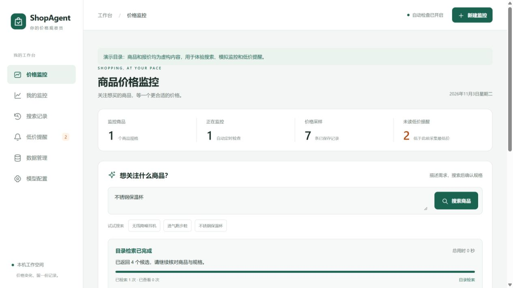

# ShopAgent Price Monitor

用自然语言寻找商品，确认规格后跟踪价格，在采集到新低价时提醒，并根据已有记录生成购买建议。

基于 **FastAPI + SQLite + 原生 HTML/CSS/JavaScript**，无需前端构建。支持 OpenAI Responses、兼容的 Chat Completions 和 Gemini 原生工具调用，也可以完全使用目录检索与规则建议。



截图使用虚构演示数据。[查看价格走势示例](docs/images/price-history.png)。

## 能做什么

- **商品搜索**：Unicode 字段加权 BM25，或由 Agent 搜索、查看详情并返回多个候选。
- **执行进度**：展示实际分析轮次、检索/查看次数、流式接收和工具补正过程。
- **价格监控**：按商品及完整规格保存，SQLite 持久化历史，后台定时采样。
- **新低提醒**：新报价严格低于此前全部已采集报价才提醒；首次、同价和历史补录不提醒。
- **价格模拟**：事件驱动调价/限时促销，以及五种确定性场景回放。
- **购买建议**：结合预算、急用程度与已采集价格给出建议和依据，失败时使用规则建议。
- **模型设置与搜索记录**：页面配置模型、查看过去候选、继续加入监控。

## 快速开始

需要 Python 3.11 或更高版本。

命令行帮助与错误输出统一使用 UTF-8，重定向到文件时也不依赖系统语言。

Windows PowerShell：

```powershell
py -3 -m venv .venv
.\.venv\Scripts\python.exe -m pip install -e .
.\.venv\Scripts\python.exe -m shopagent_monitor
```

macOS / Linux：

```bash
python3 -m venv .venv
.venv/bin/python -m pip install -e .
.venv/bin/python -m shopagent_monitor
```

打开 [http://127.0.0.1:8090](http://127.0.0.1:8090)。安装后也可执行 `shopagent-monitor`，或运行 `run_price_monitor.py`。

首次启动使用随包提供的 **12 个虚构商品**，默认关闭模型，搜索、模拟、曲线、提醒和规则建议均可直接体验。页面会标识演示目录。试试“不锈钢保温杯”“无线降噪耳机”或“透气跑步鞋”，查看详情后加入模拟监控。默认每 30 秒推进一个模拟时间步。

当前应用面向本机单用户。现阶段的价格来源是目录、导入快照和模拟器；真实电商平台的持续报价接口尚未接入。“历史最低价”指本应用开始采集以来的最低价。

## 接入模型

在“模型配置”页面选择协议，填写模型和根地址，测试连接后保存。Responses 可开启流式状态；思考强度、上下文预算、超时、网络重试次数和搜索操作上限均可调整。

也可以在首次启动时传入配置：

```powershell
.\.venv\Scripts\python.exe -m shopagent_monitor --model-config examples/model-local-responses.json
```

示例默认连接本机 `127.0.0.1:8080/v1` 的 MiniCPM5-2B；模型服务和权重需自行准备。其他服务可参考 [模型配置说明](docs/model-configuration.md)，模型名称请使用供应商实际支持的值。已保存的页面配置优先于启动配置，`--catalog-only` 可在本次启动关闭模型。

模型请求超时只重试当前轮；无效工具调用最多补正 2 次并计入总轮次，已有搜索和详情保留。最终仍未完成筛选时，已有候选以“筛选未完成”返回并保存，尚无候选才回退目录检索。

## 自有目录与本机数据

```powershell
.\.venv\Scripts\python.exe -m shopagent_monitor --dataset local-data/catalog.json --data-dir .shopagent
```

目录格式见 [商品目录说明](docs/catalog-format.md) 和 [示例文件](examples/catalog.example.json)。随包演示数据为自造内容；外部数据由使用者自行提供。

默认本机状态保存在启动目录下的 `.shopagent/`：

```text
.shopagent/
  monitor.sqlite3           # 监控、价格、提醒及搜索历史
  secrets/model.json        # 本机模型设置
  secrets/credentials-*.json # 独立凭据文件
```

`--data-dir` 或 `SHOPAGENT_DATA_DIR` 可指定固定位置，跨目录启动时请保持一致。备份整个状态目录可保留配置与历史；运行中的 SQLite 需使用一致性备份。凭据仅保存于本机文件，未加密，不会回显到页面；此目录已被 Git 忽略。

## 代码结构

```text
src/shopagent_monitor/
  app/                 # API、Agent、监控、模拟、SQLite 及静态前端
  llm/                 # 配置、消息、三种协议、SSE 与上下文预算
  resources/           # 虚构演示目录和固定检索配置
  catalog_retrieval.py # 确定性的字段加权 Unicode BM25
  data.py              # 公开商品字段加载
  cli.py               # 命令行入口
examples/              # 无凭据的模型配置和目录示例
tests/                 # 独立、无需外部模型的应用测试
docs/                  # 架构、数据、模型配置与截图
```

API 文档在运行后的 `/docs`。流程与接口见 [架构说明](docs/architecture.md)。历史购买、自进化和评测工程不属于此仓库，测试不依赖其报告或数据。

## 开发与验证

```powershell
.\.venv\Scripts\python.exe -m pip install -e ".[dev]"
.\.venv\Scripts\python.exe -m unittest discover -s tests -v
.\.venv\Scripts\python.exe -m ruff check src tests tools
node --check src/shopagent_monitor/app/static/app.js
```

Node 只用于可选的 JavaScript 语法检查。CI 在 Windows / Ubuntu、Python 3.11 / 3.12 上执行单测和打包验证；测试使用临时数据库、虚构商品和受控模型响应。贡献约定见 [CONTRIBUTING.md](CONTRIBUTING.md)，运行边界见 [SECURITY.md](SECURITY.md)。

准备发布前可运行 `python tools/check_release.py` 检查已加入 Git 的文件，以及 `python -m build` 构建安装包。安装 wheel 后执行 `python tools/verify_install.py`，确认网页和演示数据随包分发。版本与验证记录见 [CHANGELOG.md](CHANGELOG.md)。

## 许可证

代码与自造演示数据采用 [MIT License](LICENSE)。依赖保留各自的许可证，来源说明见 [NOTICE](NOTICE)。
