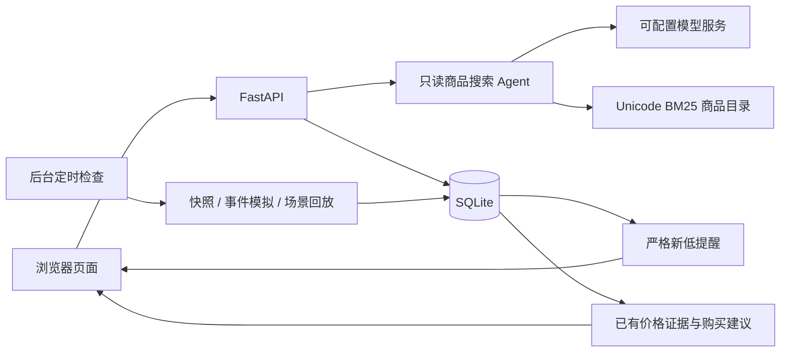

# 架构与行为

## 商品搜索

`MonitoringAgent` 只注册 `search`、`inspect_product`、`finish`。候选商品 ID 必须来自本次搜索已见结果，切换关键词后仍可查看此前已见的商品。用户确认商品与完整规格后，Web 服务才创建监控；搜索 Agent 不购买、不自行入库。

每轮保留完整消息、已完成工具和公开结果，预先计算输入、工具 Schema、输出预留与 256 Token 余量。客户端预算不足时不发送、不静默删历史。Responses SSE 只展示阶段和接收字符数，完整响应结束并通过工具名、JSON Schema 和商品来源校验后才执行工具。

网络超时、临时连接错误及 HTTP 408/429/500/502/503/504 按配置重试当前轮，退避为 1、2、4、5、5 秒。格式不正确或缺少有效工具调用时，追加固定协议提醒，每次搜索累计最多补正 2 次；补正计入模型总轮次但不扣搜索或查看额度。失败文本和非法调用不加入有效工具历史。

搜索正常结束返回 `engine=model`、`selection_complete=true`；空候选也是正常完成。补正、网络重试或总轮次用尽后，有候选则返回 `engine=partial`、`selection_complete=false`，页面与搜索历史明确标记筛选未完成。无候选时才执行目录回退，返回 `engine=catalog`。模型关闭或忙时也使用目录搜索。

## 监控与价格

监控按商品 ID 和完整规格建立。报价必须能确定所选组合的价格，缺选项、不可用或选项价格冲突时拒绝创建。价格使用整数分比较，时间使用带时区的 UTC 时间。

新报价严格低于此前已采集的所有价格时生成提醒。首次报价、同价、回涨和旧时间的历史补录不产生新低提醒。重复报价幂等；导入批次遇到错误整批回滚。提醒与报价在同一事务写入。

后台检查仅在服务运行时工作，SQLite 保存到期时间与租约以避免重叠采样。服务停止不会继续采集；重启后处理到期监控，不补造中间价格。长历史低价依据完整数据库，而非曲线中最近 2000 条记录。

## 模拟与回放

事件模拟由种子、起点和步号确定价格世界，包含日常小调价、促销开始、持续与结束。同一步重复检查不改变价格；状态持久化后重启不重置时钟。

固定场景为 `new_lows`、`promotion`、`stable`、`continuous_lows`、`failure_recovery`。每步以初始报价的百分比生成实际价格，失败步骤不写成零价。回放结束停止监控；重新回放会保留旧历史并新建一轮。暂停或采样过慢可能错过中间步骤。

真实平台适配器实现 `app.domain.PriceProvider.fetch(watch, now=...)`，只返回当前已选规格的 `PriceQuote`。取价不明确时抛出错误，不能猜测或写零价。

## 购买建议

程序计算当前价、采集最低价、排除当前报价的先前低价、采样数量和最近至多 12 条报价。模型先读取摘要，再选择允许的结论与已有证据；文案中的金额由程序生成。超预算、报价失败、数据过期和样本不足均限制可给出的结论。

模型和规则建议都只读取已有采样，模拟种子、场景未来序列及内部状态不提供给模型。新采样、错误、偏好或监控状态变化后，旧建议失效。建议不会自动购买。

## 主要接口

| 接口 | 用途 |
| --- | --- |
| `GET /api/status` | 统计、后台检查与演示目录状态 |
| `POST /api/search`、`POST /api/search/stream` | 最终 JSON 或 NDJSON 进度搜索 |
| `GET /api/search-history`、`GET /api/search-history/{id}` | 搜索列表和候选快照 |
| `GET /api/products/{asin}`、`POST /api/products/{asin}/quote` | 公开详情与规格报价 |
| `GET/POST /api/watches` | 查看或建立监控 |
| `GET /api/watches/{id}/history` | 已采集价格历史 |
| `POST /api/watches/{id}/advice` | 基于现有证据生成建议 |
| `POST /api/prices/import` | 批量导入价格快照 |
| `GET /api/alerts` | 新低提醒 |
| `GET/PUT /api/model-settings` | 本机模型配置 |
| `POST /api/model-settings/test/stream` | 草稿配置的流式连接测试 |

完整请求字段和其他监控操作以运行后的 `/docs` 为准。
