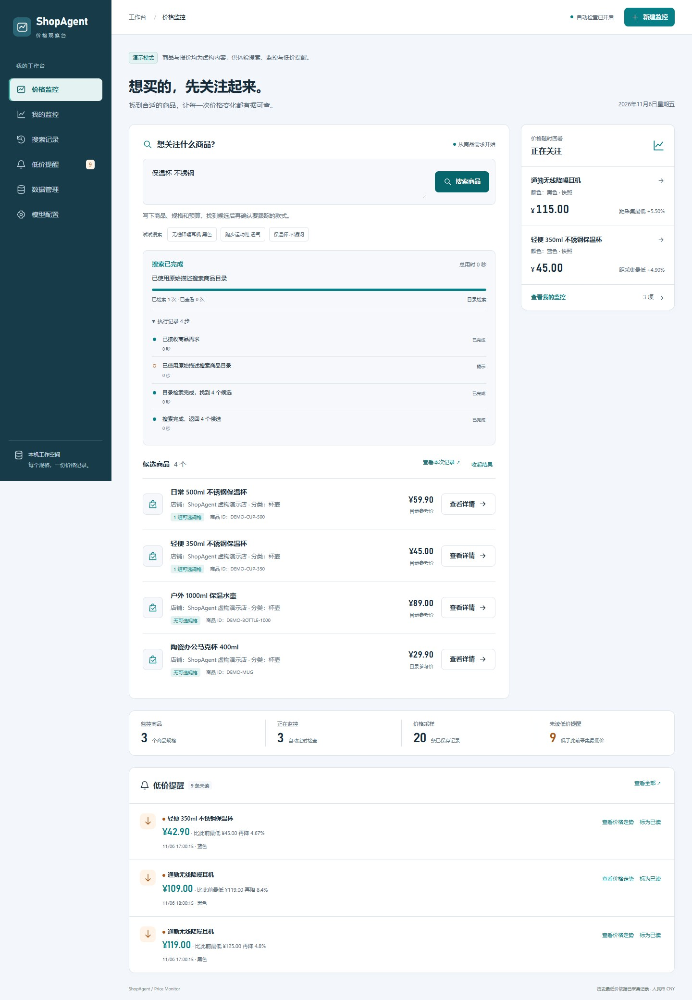
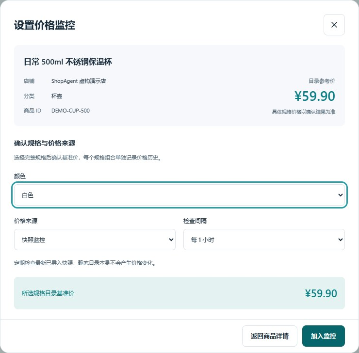
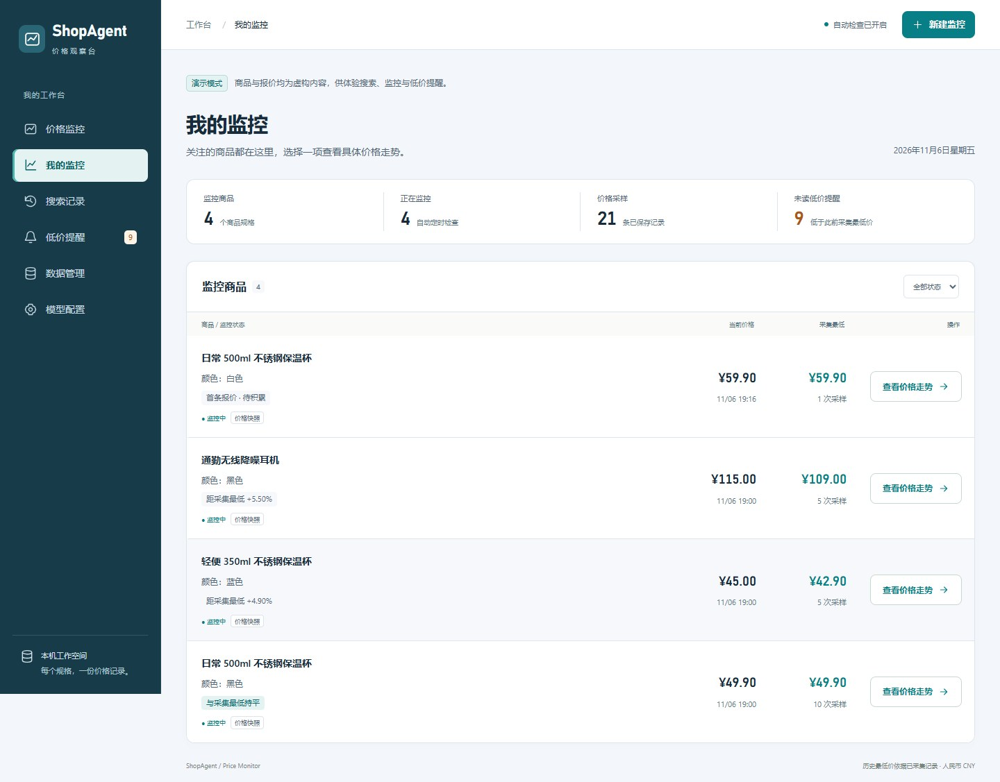
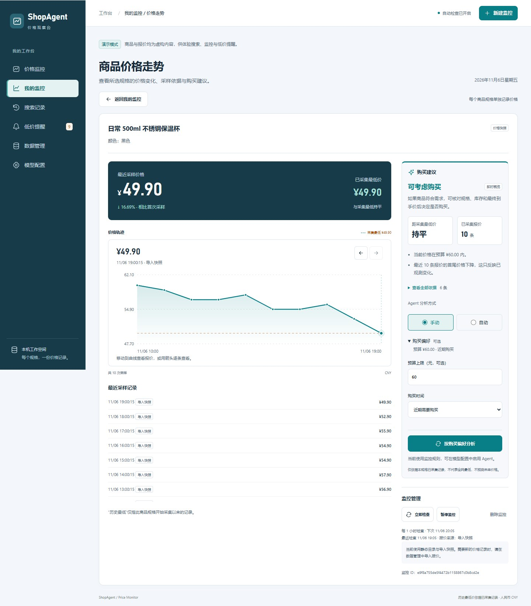
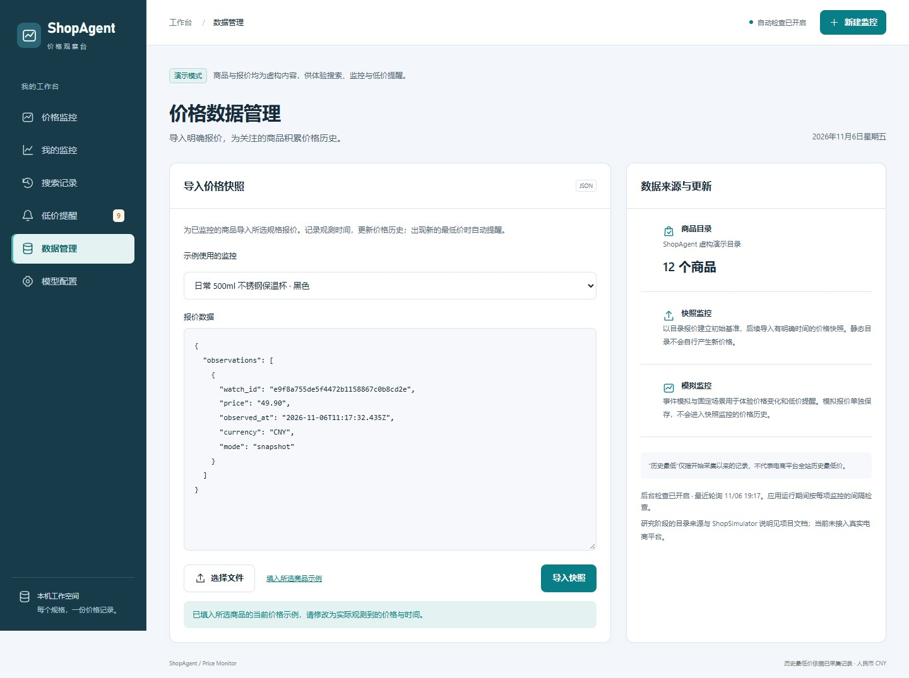
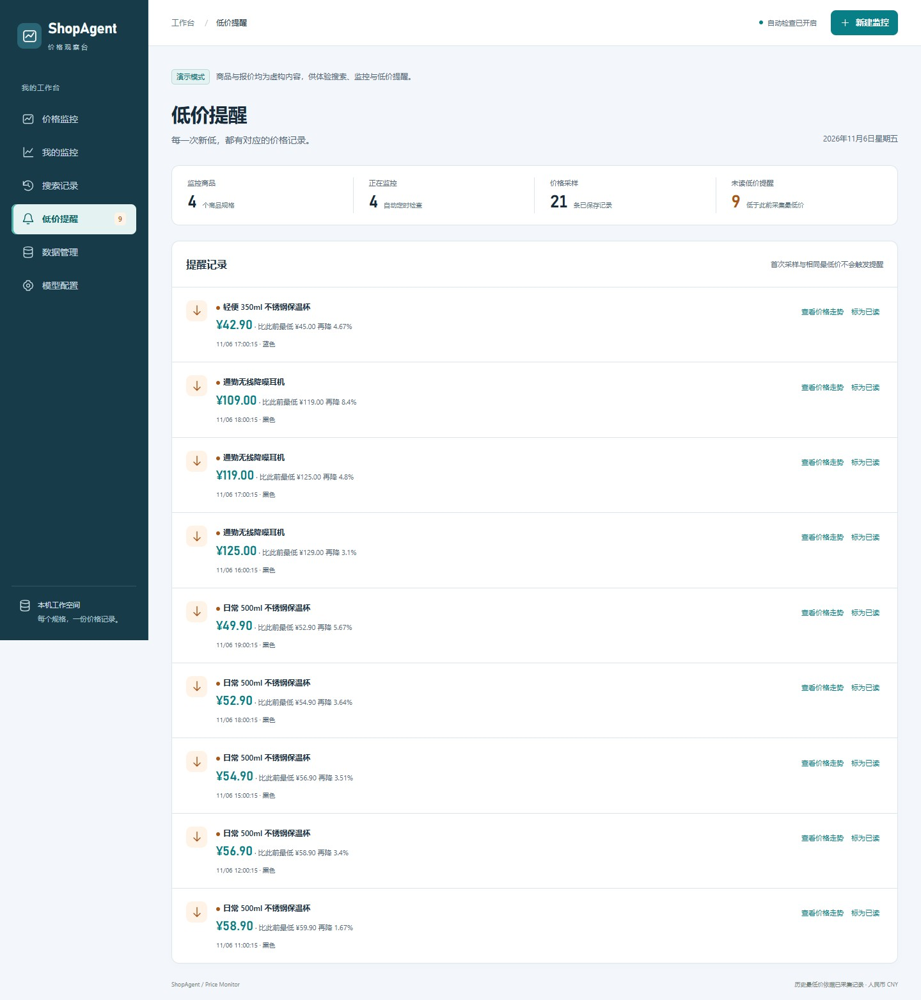
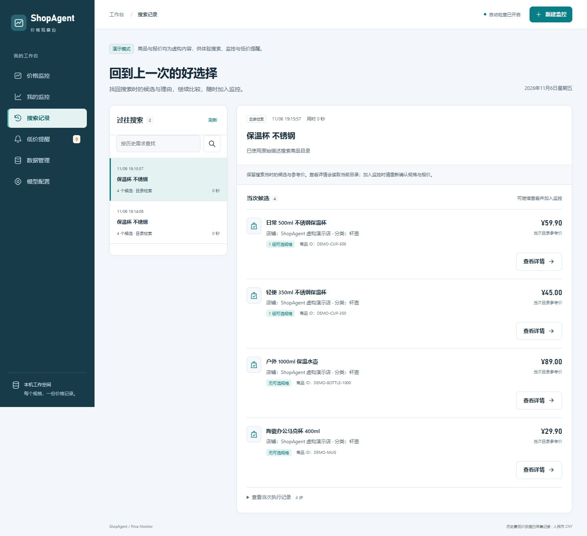
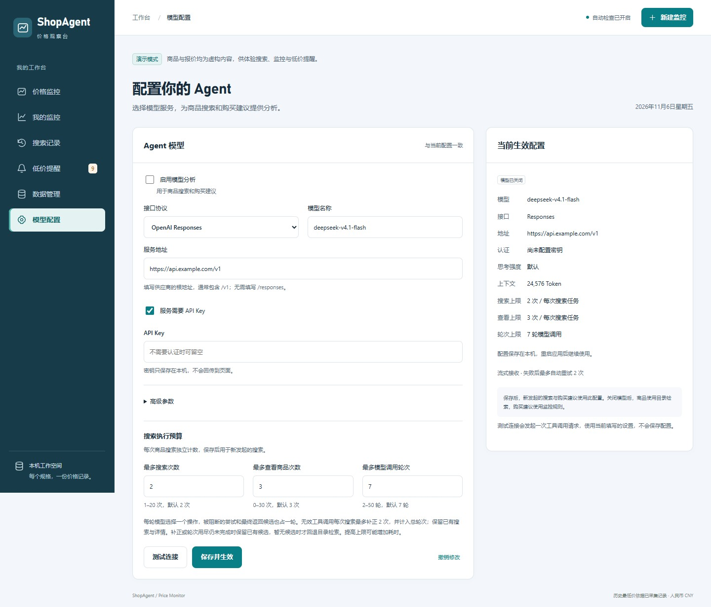

# 主要功能图文演示

[返回 README](../README.md)

这份演示按日常使用顺序，展示如何从“想买一个保温杯”走到价格跟踪与购买判断。启动方法见 [快速开始](../README.md#快速开始)。

截图来自独立演示环境，商品均为随包的虚构商品，历史报价为预先导入的演示数据。新安装不会自动拥有截图中的监控与历史。搜索截图使用目录检索，购买建议使用本地规则；本演示未调用外部模型服务。

首页将商品搜索与已关注商品放在一起，便于开始新搜索或回看已有监控。进入详情后，曲线支持移动指针查看单条报价，也可以用前后按钮逐条读取金额、时间和来源；手机会按容器宽度绘制坐标。

## 1. 描述需求，查看多个候选

进入“价格监控”，输入“保温杯 不锈钢”，点击“搜索商品”。页面会显示执行进度与候选列表，保留商品名称、店铺、分类、目录参考价和规格组信息。点击“执行记录”可展开本次实际步骤。

无需模型即可使用目录检索。启用模型后，也可以描述“想找一个 500ml 不锈钢保温杯，通勤用，预算 60 元”，由 Agent 在配置的预算内搜索、查看详情并返回候选。目录检索主要按词面相关性排序，仍需核对容量、材质与规格是否符合需求。

## 2. 查看详情，确认规格并加入监控

点击候选的“查看详情”，阅读商品参数、介绍和可选规格，再点击“设置价格监控”。选择完整规格后，系统显示该组合的目录基准价；随后选择价格来源与检查间隔，点击“加入监控”。

例如同一个 500ml 保温杯的黑色和白色可以分别监控，各自保存价格历史。截图选择白色、快照监控和每小时检查；快照模式需要后续导入报价，静态商品目录不会自行变价。

## 3. 从“我的监控”进入单品详情

“我的监控”集中展示商品规格、运行状态、最近采样价格、已采集最低价与采样次数。可以按状态筛选，点击“查看价格走势”进入对应商品规格的详情。

演示中，白色保温杯刚加入，只有一条基准记录，显示“首条报价 · 待积累”；黑色保温杯已有十条记录，最近价格为 ¥49.90。两者不会混用历史。列表中的价格位置只对比已采集记录，不等同于新低提醒；详情中还可以立即检查、暂停或恢复监控。

## 4. 查看价格曲线，结合需求判断是否购买

单品详情同时展示最近价格、相对首次采样的变化、已采集最低价、价格曲线和采样来源。本例黑色保温杯从 ¥59.90 变为 ¥49.90，相对首次采样下降 16.69%；中间的持平、降价与反弹均来自已保存的演示报价。

展开“购买偏好”，将预算设为 60 元，购买时间选为“近期需要购买”，点击“按购买偏好分析”。截图中的规则建议为“可考虑购买”，并列出预算及已观测变化等依据；未设预算且不急用时，本例显示“建议继续观察”。建议不预测未来价格，也不代替用户确认规格和最终到手价。

接入模型后，可在“Agent 分析方式”中选择：

- **手动**：主动点击分析按钮时请求模型。
- **自动**：仅在当前详情页打开时，依据新的价格证据或购买偏好变化触发；同一份证据去重，最短调用间隔一分钟。

未启用模型时使用本地规则，页面会标明来源。价格监控的定时采样与 Agent 分析是两个独立功能。

## 5. 导入报价，持续积累价格记录

进入“数据管理”，选择对应商品规格，点击“填入所选商品示例”。模板会自动带入该监控的 ID；修改价格和带时区的观测时间后，点击“导入快照”，也可通过“选择文件”导入 JSON。

模板中的时间必须不晚于导入时刻。比如已有记录最低为 ¥52.90，导入一条时间更新、价格为 ¥49.90 的报价后，会更新曲线并生成新低提醒。再次检查同一份静态快照不会制造新的采样记录。字段说明见 [价格快照格式](catalog-format.md#价格快照)。

## 6. 查看新低提醒，回到价格依据

“低价提醒”展示触发价格、此前最低价、降幅、观测时间和对应规格。点击“查看价格走势”可返回该监控的曲线，确认提醒所依据的价格历史；处理后可以“标为已读”。

例如黑色保温杯的 ¥49.90 相比此前最低 ¥52.90 再降 5.67%，产生一条提醒。首次采样、与最低价持平、反弹以及历史补录均不会触发新低提醒。“历史最低”始终只指本应用已保存的对应规格记录。

## 7. 找回搜索记录，继续查看候选

加入监控后，过去的候选仍保存在“搜索记录”。可以按需求文本查找历史，查看当次候选、参考价与执行记录，并继续打开商品详情、确认规格和加入监控。

历史保留的是搜索当时的信息；再次查看详情会读取当前目录，加入监控时重新确认报价，避免把旧参考价当作当前规格价格。

## 8. 按需接入模型，调整执行预算

进入“模型配置”，启用模型分析，选择服务支持的 Responses 或 Chat Completions 协议，填写模型名称、供应商根地址和所需凭据。点击“测试连接”，通过后“保存并生效”。默认模型名为 `deepseek-v4.1-flash`；截图中的 `https://api.example.com/v1` 只是占位地址，尚未配置凭据。

“高级参数”可调整思考强度、上下文、输出预算、超时和网络重试；“搜索执行预算”可限制搜索次数、查看商品次数与模型调用轮次。网络超时只重试当前轮，保留已经获得的搜索与详情；工具协议补正有次数上限。具体参数与失败处理见 [模型配置说明](model-configuration.md)。

